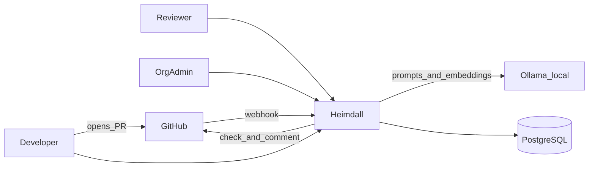
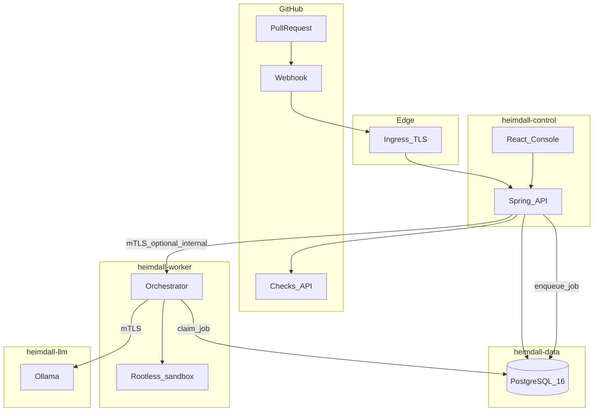
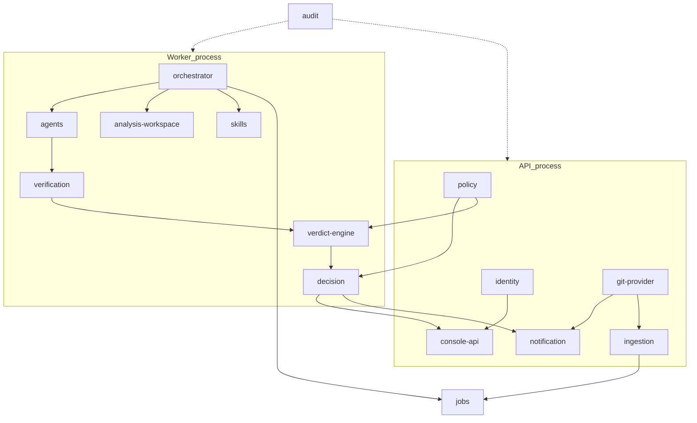
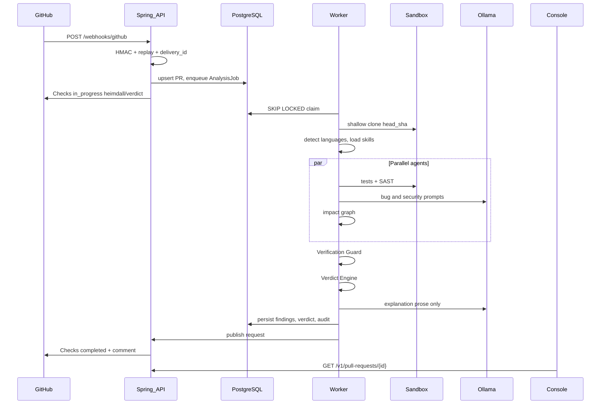
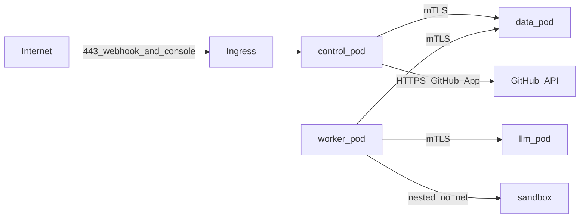

# 01 — C4 architecture

This document is the system map. Contracts live in [openapi/heimdall-api.yaml](openapi/heimdall-api.yaml) and [asyncapi/heimdall-events.yaml](asyncapi/heimdall-events.yaml). Decisions live in [adr/](adr/).

## Level 1 — System context

**People**

- Developer: opens and updates pull requests; reads Check output and Console.
- Reviewer: triages UNVERIFIED findings; may dismiss or confirm.
- Org admin: installs the GitHub App, confirms Project Skills, edits policy.

**External systems**

- GitHub: source of truth for git objects, webhooks, Checks, review comments, CODEOWNERS.
- Ollama: local LLM and embedding inference. Not a system of record.
- PostgreSQL: system of record for analyses, findings, verdicts, audit, jobs.

GitLab, Bitbucket, and Gitea are **not** in the POC context. They appear only as unimplemented Provider SPI ports. See [05-git-provider-spi.md](05-git-provider-spi.md).

## Level 2 — Containers

Four Podman pods, one internal network, one public ingress. Detail in [08-deployment-podman.md](08-deployment-podman.md).

| Container | Technology | Responsibility |
| --- | --- | --- |
| React Console | React 18, TypeScript, Vite, Tailwind, shadcn/ui | Human UI. No business rules. JWT bearer to API. |
| Spring API | Java 21, Spring Boot 3.x | Auth, webhooks, read models, enqueue analysis, publish Checks. |
| Orchestrator worker | Same modular monolith, different command | DAG execution, skill load, agents, Verdict Engine. |
| Sandbox | Rootless nested Podman | Clone + test + selected SAST. No network by default. |
| PostgreSQL | 16, CloudNativePG-compatible | OLTP, JSONB evidence, job queue (`SKIP LOCKED`), audit. |
| Ollama | Qwen2.5-Coder 14B, nomic-embed-text | Inference only. |
| Ingress | nginx or Caddy | Public TLS for Console and webhook path. |

Redis is **not** a container in the POC. Jobs live in PostgreSQL. See [adr/0008-postgres-job-queue.md](adr/0008-postgres-job-queue.md).

## Level 3 — Components (modular monolith)

Spring Modulith application, two process roles (`api`, `worker`) of one artifact.

| Module | Process | Notes |
| --- | --- | --- |
| `identity` | API | Users, orgs, JWT, RBAC (`admin`, `reviewer`, `viewer`). |
| `git-provider` | API + worker | SPI + GitHub App adapter. |
| `ingestion` | API | HMAC, replay window, normalize, idempotent enqueue. |
| `jobs` | both | PostgreSQL queue, run lease, retry, poison. |
| `skills` | worker | Load Language Skills + Project Skill into the workspace. |
| `analysis-workspace` | worker | Single clone, diff, AST, embeddings, tool outputs. |
| `agents` | worker | Bug, Security, Test, Impact, Reviewer, Summary. |
| `verification` | worker | Independent Verification Guard. |
| `verdict-engine` | worker | Deterministic score. **No LLM.** |
| `decision` | worker | MERGE / REVIEW / BLOCK + prose explanation. |
| `policy` | both | YAML policy; hard BLOCK rules. |
| `notification` | API or worker | Checks API + PR comment. |
| `console-api` | API | Read models for the dashboard. |
| `audit` | both | Append-only events. |

## Runtime sequence — pull request opened or updated

Idempotency key: `(repository_id, pull_request_number, head_sha)`. A duplicate webhook delivery updates nothing and returns 202. A new `head_sha` starts a new `AnalysisRun` and is incremental: unchanged files reuse fingerprints and cached tool products where hashes match.

## Shared analysis workspace

Agents must not clone or parse independently.

The workspace is a directory plus a metadata store:

- `repo/` — shallow clone at `head_sha`
- `diff.patch` and file list
- `index/` — tree-sitter, import graph, embeddings chunks
- `tools/` — Semgrep, Gitleaks, Trivy, test JUnit/SARIF
- `skills/` — resolved Language Skill files + Project Skill
- `candidates/` — agent findings before verification
- `verified/` — Verification Guard output

Downstream agents read this workspace. They do not re-fetch GitHub or re-tokenize the tree.

## Trust boundaries

- Public: Ingress only.
- GitHub is trusted as the git host after HMAC verification; PR **content** is untrusted data.
- Ollama is trusted as an inference engine, not as a decision authority.
- Sandbox is hostile: it runs attacker-controlled code from the PR.

See [07-security.md](07-security.md).

## Frontend container

The Console is a static SPA served by nginx in `heimdall-control`.

- React 18 + TypeScript + Vite
- Tailwind CSS + shadcn/ui
- TanStack Query bound to the OpenAPI contract
- React Router for Console IA in [11-console.md](11-console.md)
- No Next.js, no SSR, no Vercel

## What is deliberately not a container yet

| Deferred | Why |
| --- | --- |
| Redis | Postgres job queue is enough. ADR-008. |
| Temporal | Production path, not POC. ADR-002. |
| Dedicated IdP | JWT from Heimdall; OIDC later. |
| Object storage | Clone cache on worker volume for POC. |
| GitLab / Bitbucket workers | SPI stubs only. |
