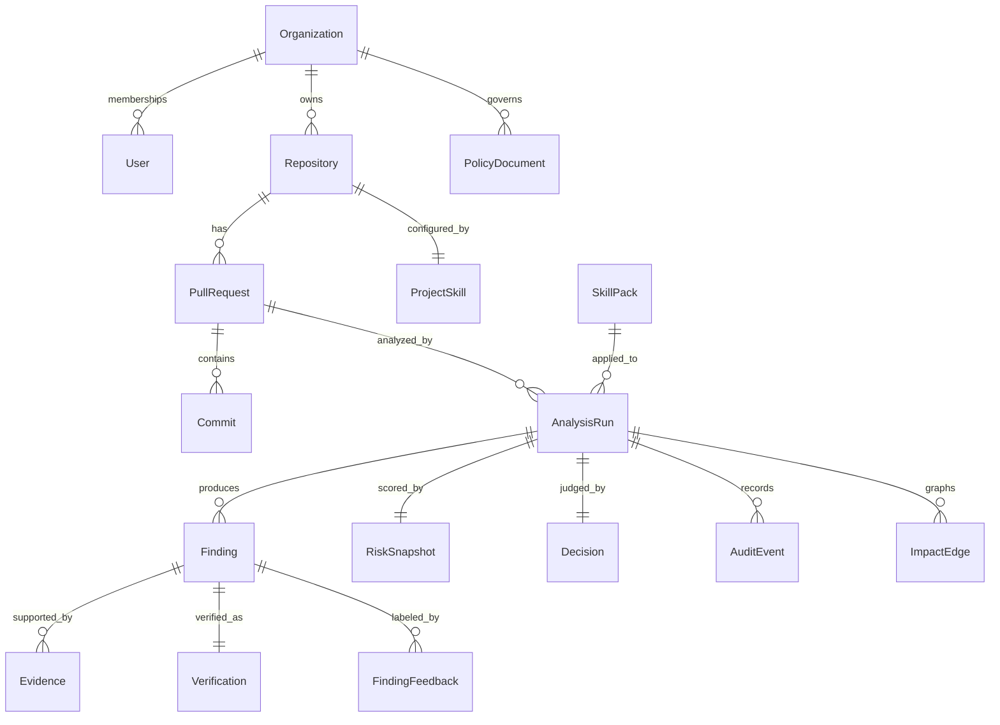

# 02 — Domain model

POC tenancy: **single-tenant ready for multi-tenant**. Every table has `org_id`. Row-level security is later.

## Bounded contexts

| Context | Aggregate roots | Published language |
| --- | --- | --- |
| Identity and tenancy | Organization, User, Membership | `org_id`, roles |
| Git provider | Repository, PullRequest, Commit, Check | Provider-neutral IDs + native IDs |
| Skills | SkillPack, ProjectSkill | `skill_id`, `skill_version` |
| Analysis | AnalysisRun, AnalysisJob, WorkspaceRef | `analysis_run_id` |
| Findings | Finding, Evidence, Verification | `fingerprint`, verification status |
| Verdict | RiskSnapshot, Decision | score, band, verdict |
| Policy | PolicyDocument | hard BLOCK classes |
| Feedback | FindingFeedback, Suppression | human labels for eval |
| Audit | AuditEvent | append-only |

## Aggregates and invariants

### Organization

- Owns repositories, policies, members, GitHub App installation.
- Invariant: one GitHub App installation per org in the POC.

### Repository

- `provider = github` for the POC.
- Holds the confirmed Project Skill and language detection snapshot from onboarding.
- Invariant: analysis cannot start without a Project Skill in `draft` or `active`. A `draft` skill is allowed so first PRs are not blocked on human confirmation; findings are marked `project_skill=draft`.

### PullRequest

- Provider-neutral number + native id.
- Tracks `base_sha`, current `head_sha`, title, author (untrusted text).
- Invariant: title/body are stored as data, never concatenated into system prompts without delimiters.

### AnalysisRun

- Idempotent on `(repository_id, pull_number, head_sha)`.
- States: `queued` → `running` → `succeeded` | `failed` | `cancelled`.
- Holds workspace locator, skill snapshot ids, tool versions, model ids, trace id.
- Incremental: `parent_run_id` when the previous head exists; file-hash cache reuse is recorded.

### Finding

- Candidate produced by an agent, then independently verified.
- Fingerprint: stable hash of `(rule_or_claim_class, normalized_location, sink_signature)`.
- Invariant: `verification_status` is written only by the Verification Guard or a human reviewer, never by the proposing agent.
- Invariant: `severity` may be downgraded by verification; it is never upgraded solely by LLM prose.

### Evidence

- Child of Finding. One finding, many evidence items.
- Kinds: `code_location`, `ast_trace`, `static_analysis`, `test_result`, `dependency`, `reproduction`, `secret_fingerprint`, `policy`.
- Raw secrets are forbidden. Store location + fingerprint only.

### Verification

- Status: `VERIFIED` | `UNVERIFIED` | `REJECTED` | `FALSE_POSITIVE`.
- `method`: tools used, confidence, reason.
- Invariant: `VERIFIED` + `severity=critical` requires at least one non-LLM evidence kind.

### RiskSnapshot

- Produced by Verdict Engine. Immutable per run.
- Breakdown JSON: `{ bug, security, testing, impact, size, dependency, policy }`.
- `inputs_hash` covers findings, test summary, impact, policy version, weight version.

### Decision

- `MERGE` | `REVIEW` | `BLOCK`
- `explanation` is generated after the verdict; changing prose does not change the verdict.
- `check_conclusion` maps to GitHub Check: MERGE → success, REVIEW → neutral, BLOCK → failure.

### SkillPack / ProjectSkill

- SkillPack: versioned language pack (`java@1.2.0`).
- ProjectSkill: per repository, `draft` | `active` | `archived`.
- Analysis stores the exact versions used (reproducibility).

### PolicyDocument

- YAML document, versioned.
- Hard BLOCK rules are evaluated after scoring; they can override a low score to BLOCK.

### AuditEvent

- Append-only. No updates, no deletes in the POC.
- `actor_type`: `system`, `user`, `github`.
- Payload JSONB; never includes raw secrets or full file blobs.

## Entity-relationship sketch



## Logical tables (implementation later)

Design rules: UUID primary keys, `org_id` on every table, `created_at` timestamptz, JSONB for tool payloads, no ORM lazy graphs across context boundaries.

| Table | Keys / notes |
| --- | --- |
| `organizations` | uuid PK |
| `users` | uuid PK, email unique per org |
| `memberships` | `(org_id, user_id)`, role enum |
| `repositories` | uuid PK, `(org_id, provider, native_id)` unique |
| `pull_requests` | uuid PK, `(repository_id, number)` unique |
| `commits` | `(repository_id, sha)` unique |
| `analysis_runs` | uuid PK, `(repository_id, pr_number, head_sha)` unique |
| `analysis_jobs` | uuid PK, `run_id`, state, `locked_at`, `locked_by`, `attempts` |
| `findings` | uuid PK, `run_id`, `fingerprint`, agent, severity |
| `evidence` | uuid PK, `finding_id`, kind, payload jsonb |
| `verifications` | uuid PK, `finding_id` unique |
| `risk_snapshots` | uuid PK, `run_id` unique |
| `decisions` | uuid PK, `run_id` unique |
| `skill_packs` | `(skill_id, version)` unique |
| `project_skills` | `repository_id` unique for active |
| `policies` | `(org_id, version)` |
| `impact_edges` | `run_id`, from_ref, to_ref, kind |
| `finding_feedback` | finding fingerprint + user + label |
| `suppressions` | org/repo + fingerprint + expiry |
| `audit_events` | bigserial or uuid, no update trigger |
| `eval_labels` | gold labels for the harness |

Job claim:

```sql
UPDATE analysis_jobs
SET state = 'running', locked_at = now(), locked_by = :worker
WHERE id = (
  SELECT id FROM analysis_jobs
  WHERE state = 'queued'
  ORDER BY created_at
  FOR UPDATE SKIP LOCKED
  LIMIT 1
)
RETURNING *;
```

## Finding fingerprint

Purpose: stable identity across commits so risk evolution and suppressions work.

```text
fingerprint = sha256(
  org_id + repo_id + claim_class + path_normalized + symbol_or_sink + rule_id
)
```

Path normalization strips generated prefixes and honors `.heimdallignore` / linguist generated-file flags. If the sink moves inside the same file, a secondary `fuzzy_fingerprint` (claim_class + symbol) supports matching.

## Untrusted fields

The following are **untrusted** and must never be interpolated into skill text or system prompts as instructions:

- PR title, body, review comments, commit messages
- File contents from the head clone
- CODEOWNERS file contents (trusted for reviewer routing, not for prompt control)
- GitHub username strings in generated markdown

Delimited injection:

```text
<untrusted kind="pull_request_body">
...raw...
</untrusted>
```

## Read models for the Console

Not separate databases. SQL views or query services:

- `pr_overview` — latest run verdict, score, counts
- `finding_inbox` — UNVERIFIED high/critical
- `risk_evolution` — score per `head_sha`
- `impact_graph` — edges for a run
- `audit_feed` — recent events for a PR

## Cloud-native PostgreSQL notes

Schema must remain compatible with CloudNativePG:

- No required superuser extensions beyond `pgcrypto` / `uuid-ossp` (prefer `gen_random_uuid()`).
- Connection pooling assumed (PgBouncer later); no session-level state.
- JSONB indexes: GIN on `evidence.payload` only where query patterns exist.
- Migrations via Flyway in the implementation phase; this POC does not ship SQL files.
