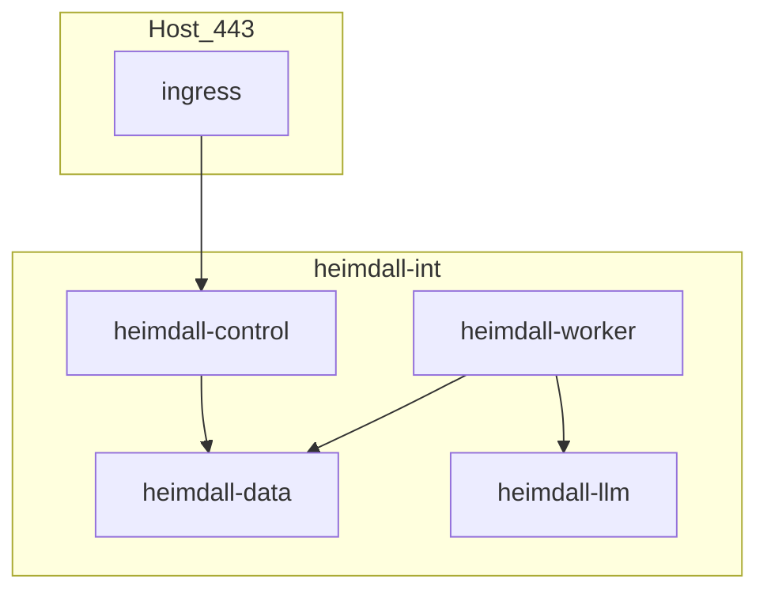

# 08 — Deployment (Podman pods)

POC runtime topology. No Kubernetes required. Quadlet units are specified here; files are not shipped as code in this phase.

See [adr/0007-podman-mtls-jwt-hmac.md](adr/0007-podman-mtls-jwt-hmac.md).

## Pods

One user-defined network `heimdall-int` (internal). Ingress publishes 443.



| Pod | Containers | Ports (internal) | Volume |
| --- | --- | --- | --- |
| `heimdall-control` | `api` (Spring), `web` (nginx static Console + TLS reverse proxy to api) | 8443 web, 8080 api localhost | none required |
| `heimdall-data` | `postgres` 16 | 5432 | `pgdata` |
| `heimdall-worker` | `worker` (Spring), `sandbox-runtime` (podman + pause) | none public | `workspace-cache` |
| `heimdall-llm` | `ollama`, `proxy` (nginx mTLS sidecar) | 11443 proxy | `ollama-models` |

GPU: if present, pass `--device nvidia.com/gpu=all` (or equivalent) to `ollama`. CPU-only is supported with the 7B model.

## Images (implementation later)

| Container | Base (intent) |
| --- | --- |
| api / worker | `eclipse-temurin:21-jre` custom image, same artifact, different `SPRING_PROFILES_ACTIVE` |
| web | `nginx:stable` |
| postgres | `postgres:16` |
| ollama | official `ollama/ollama` |
| sandbox | distroless or fedora-minimal with git + language toolchains as needed |

Pin by digest in Quadlet `Image=`.

## Quadlet sketch

`/etc/containers/systemd/heimdall-control.pod`

```ini
[Pod]
PodName=heimdall-control
Network=heimdall-int.network
PublishPort=443:8443
```

Each `.container` sets `Pod=heimdall-control.pod`, `UserNS=auto` where possible, `ReadOnly=true`, `NoNewPrivileges=true`.

Worker needs extra privileges only for nested containers: document `podman` in podman with `/run/user` socket **not** exposed to sandbox children.

## Secrets (Podman secrets)

| Secret | Used by |
| --- | --- |
| `heimdall-jwt-rs256` | api |
| `heimdall-db-password` | api, worker, postgres |
| `heimdall-github-app-pem` | api, worker (clone token mint) |
| `heimdall-github-webhook` | api |
| `heimdall-ca` / `heimdall-api-cert` / `heimdall-worker-cert` / `heimdall-llm-cert` / `heimdall-pg-cert` | all |
| `heimdall-secret-pepper` | worker (secret fingerprints) |

Never commit these. Bootstrap script (later) generates CA and JWT keypair.

## DNS / hostnames

Internal: `api.heimdall.internal`, `postgres.heimdall.internal`, `ollama.heimdall.internal` via Podman network aliases.

## PostgreSQL

- 16, UTF8, `ssl=on`.
- Database `heimdall`, role `heimdall`.
- CloudNativePG-compatible: no superuser extensions required.
- Backup: `pg_dump` to host path or volume snapshot. Document daily cron on the host. PITR later with CloudNativePG wal archive.
- POC does not run PgBouncer. Add when connections exceed ~50.

## Ollama models

Pull at provision:

```text
ollama pull qwen2.5-coder:14b
ollama pull qwen2.5-coder:7b
ollama pull nomic-embed-text
```

Hardware:

| VRAM | Use |
| --- | --- |
| CPU / 8 GB | 7B Q4 only |
| 16–24 GB | **14B Q4/Q5** recommended |
| 24 GB+ | 14B Q5/Q8 or 32B / Qwen3-Coder if available |

Env: `OLLAMA_HOST=127.0.0.1:11434` behind mTLS proxy.

Health: `GET https://ollama.heimdall.internal:11443/api/tags` with client cert.

## Ingress

Public paths:

| Path | Auth | Backend |
| --- | --- | --- |
| `/` Console SPA | none (SPA), API calls JWT | static |
| `/v1/*` API | JWT except health | api |
| `/webhooks/github` | HMAC | api |
| `/actuator/health` | none, no details | api |

TLS cert: operator-provided (Let’s Encrypt on host or internal PKI). Separate from mTLS CA.

## Resource budgets (defaults)

| Pod | CPU | RAM |
| --- | --- | --- |
| control | 1 | 1.5 GB |
| data | 1 | 2 GB |
| worker | 2 | 4 GB + sandbox |
| llm | 4 | 16 GB+ (model) |

Analysis SLO depends on GPU. See [09-observability-and-audit.md](09-observability-and-audit.md).

## Network policy (intent)

- llm pod: accept 11443 only from worker.
- data pod: accept 5432 only from control and worker.
- worker: egress to GitHub HTTPS for clone (or clone via API machine then copy — prefer worker egress allowlist `github.com`, `api.github.com`).
- sandbox: none.

## Bootstrap order

1. Create network and secrets/CA.
2. Start data; wait for healthy Postgres.
3. Start llm; pull models.
4. Start control; run Flyway (implementation phase).
5. Start worker.
6. Register GitHub App webhook URL `https://<public>/webhooks/github`.

## Operations

- Rollback: previous image digest + Postgres is forward-compatible for one minor.
- Workspace cache eviction: `workspace.retain_hours=24`.
- Logs: `podman logs` + journald via Quadlet; ship later to Loki/ELK.

## Non-goals

- Helm charts, OpenShift operators, Vercel, Render, Railway.
- Multi-host swarm. Single host POC. HA Postgres later via CloudNativePG.
